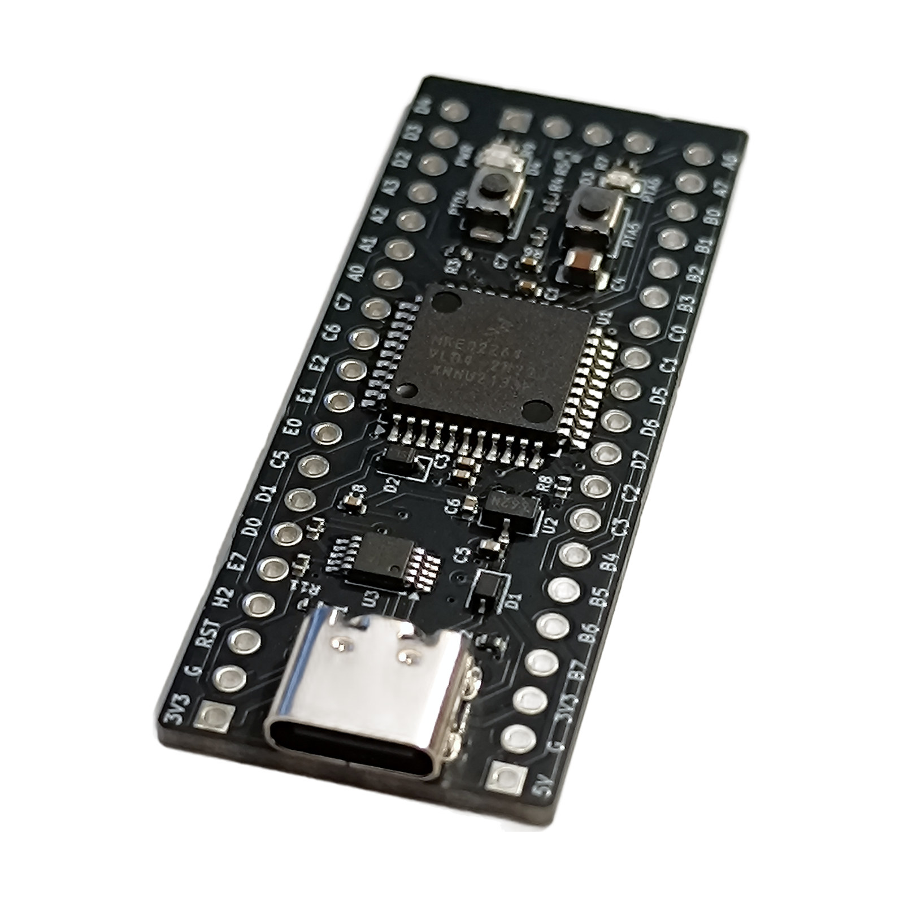

# KE Black Pill — NXP Kinetis KE02 / KE04 development module (HC26060)

A small, breadboard-friendly development module for the **NXP Kinetis E** series, in the
popular **Black Pill size**. Choose the **KE02** (40 MHz) or the **KE04** (48 MHz) — both an
Arm Cortex-M0+ with 64 KB flash that runs from **2.7 V to 5.5 V**, so you can work at **3.3 V or
5 V** logic. USB-C gives you power **and a serial console** over one cable; program and debug
over **SWD**. All usable I/O is on two 1x20 headers.

> 🛒 **Buy:** Tindie — coming soon · Lectronz — coming soon <!-- ⟨TODO: product links once listed⟩ -->
> 🔌 Need a programmer? KE02/KE04 support for the [HardCode Flash Station](https://github.com/hardcodebr) is in development. <!-- ⟨CONFIRM: change to "supported" + product link after the station bench acceptance⟩ -->

## Features
- **NXP Kinetis KE02 or KE04** (MKE02Z64 / MKE04Z64), Arm Cortex-M0+, 64 KB flash
- **3.3 V or 5 V operation** (MCU range 2.7–5.5 V) — I/O levels follow the supply
- **34 GPIO + RESET** on 2 × 1x20 headers, 2.54 mm pitch, rows 0.6 in apart — fits a breadboard
- 12 ADC channels (12-bit), PWM timers, 3 UARTs, 2 SPI, I2C (two on the KE04), 2 analog comparators
- **USB-C** 5 V power + **on-board USB-serial** on UART0 — serial console over the same cable
- On-board 3.3 V regulator; protected power paths (USB, 5V pin and 3V3 pins don't back-feed each other)
- **SWD header** (1x4, right-angle) for programming and debugging
- **RESET** and **USER** buttons, red user LED, green power LED
- No crystal needed (internal clock); the crystal pins are free I/O
- Black Pill size: **20.78 × 52.81 mm**; headers ship loose

## Documentation
- [Schematic (PDF)](docs/hardware/)
- [Quick-Start (power, serial, first program, flashing)](docs/index.md)
- [Datasheet](docs/datasheet.md)
- [Pinout](docs/pinout.md)
- [FAQ / Troubleshooting](docs/faq.md)

## What's in the box
HC26060 module (KE02 or KE04, as ordered) · 2× 1x20 pin headers + 1× 1x4 right-angle SWD header
(loose, to solder) · quick-start card · ESD bag. USB-C cable and SWD probe not included.
<!-- ⟨CONFIRM: owner decision — headers loose vs pre-soldered, cable option⟩ -->

*Rev A — first production batch.*

---
Made by [HardCode](https://hardcode.tools) · support@hardcode.tools
*The schematic is provided as a PDF ([docs/hardware](docs/hardware/)). The editable hardware design files (KiCad sources, layout, Gerbers) are not published.* ⟨TODO: publish the cleaned-up schematic⟩

## 💬 Feedback
Suggestions or questions → [open a discussion](https://github.com/hardcodebr/ke-black-pill/discussions) · support@hardcode.tools
<!-- ⟨TODO: enable GitHub Discussions on the repo when it is published⟩ -->
